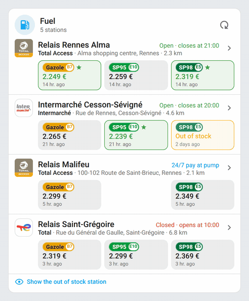
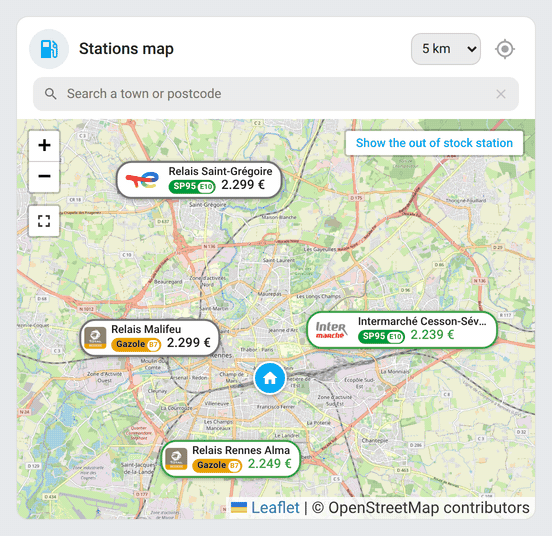
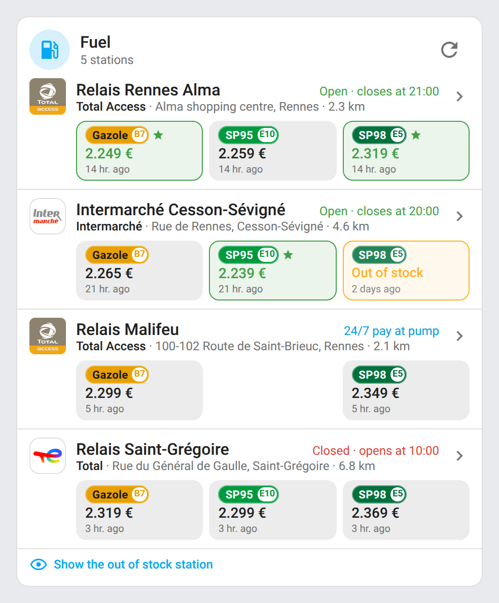
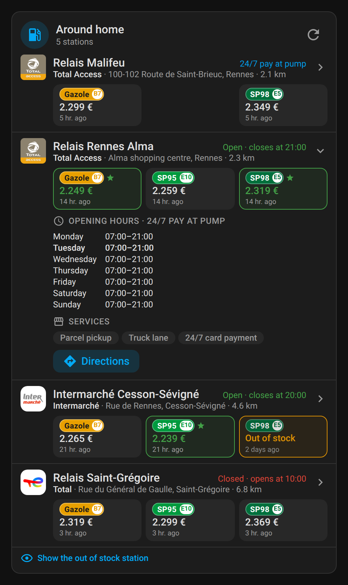
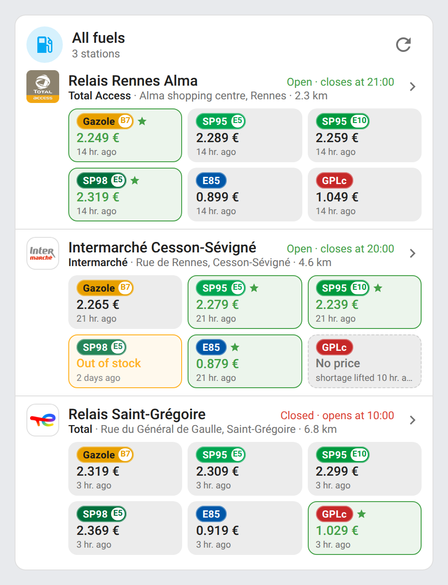
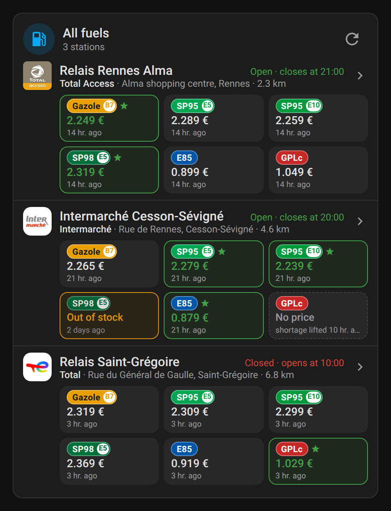
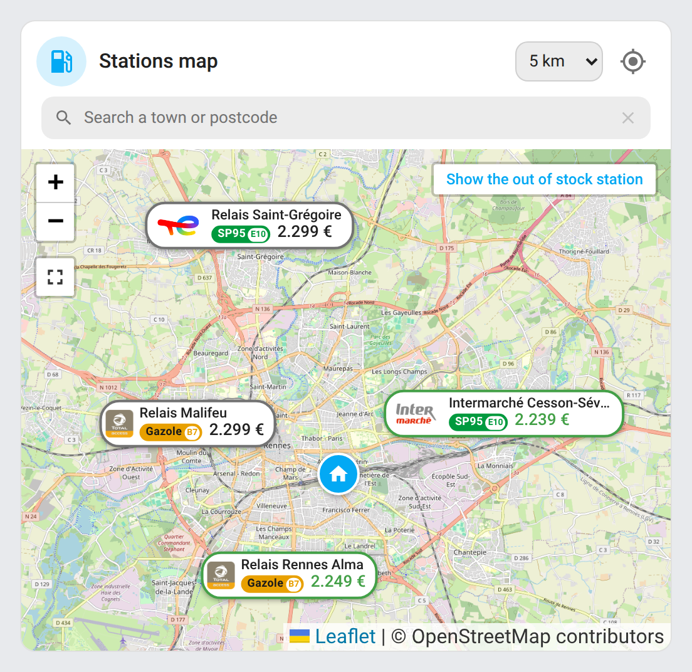
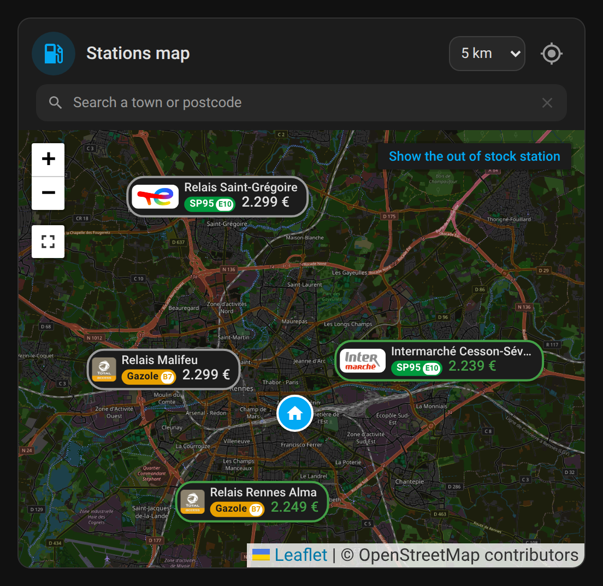
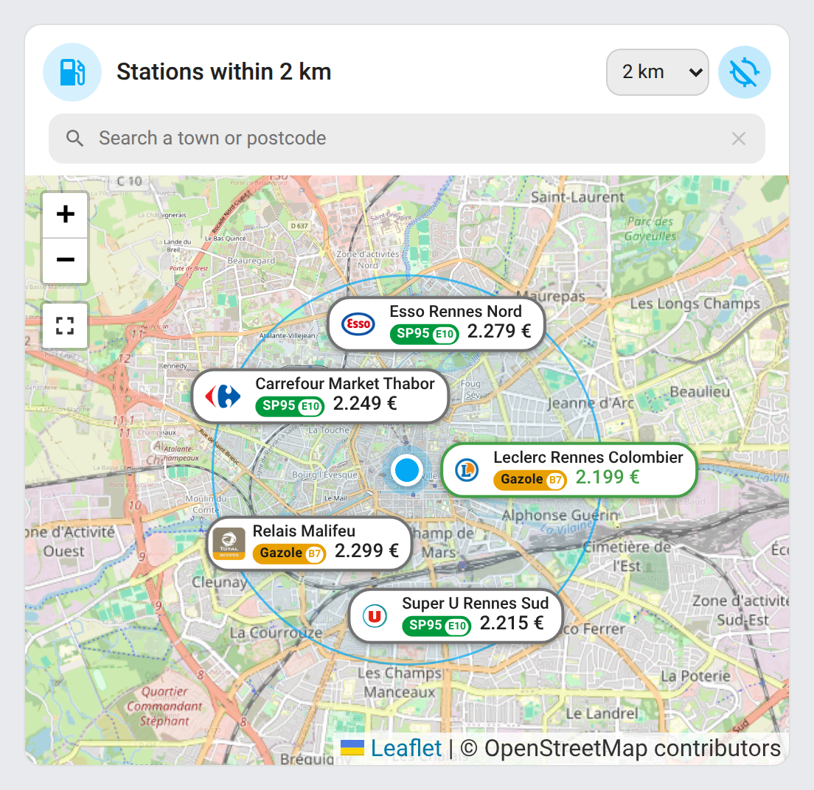
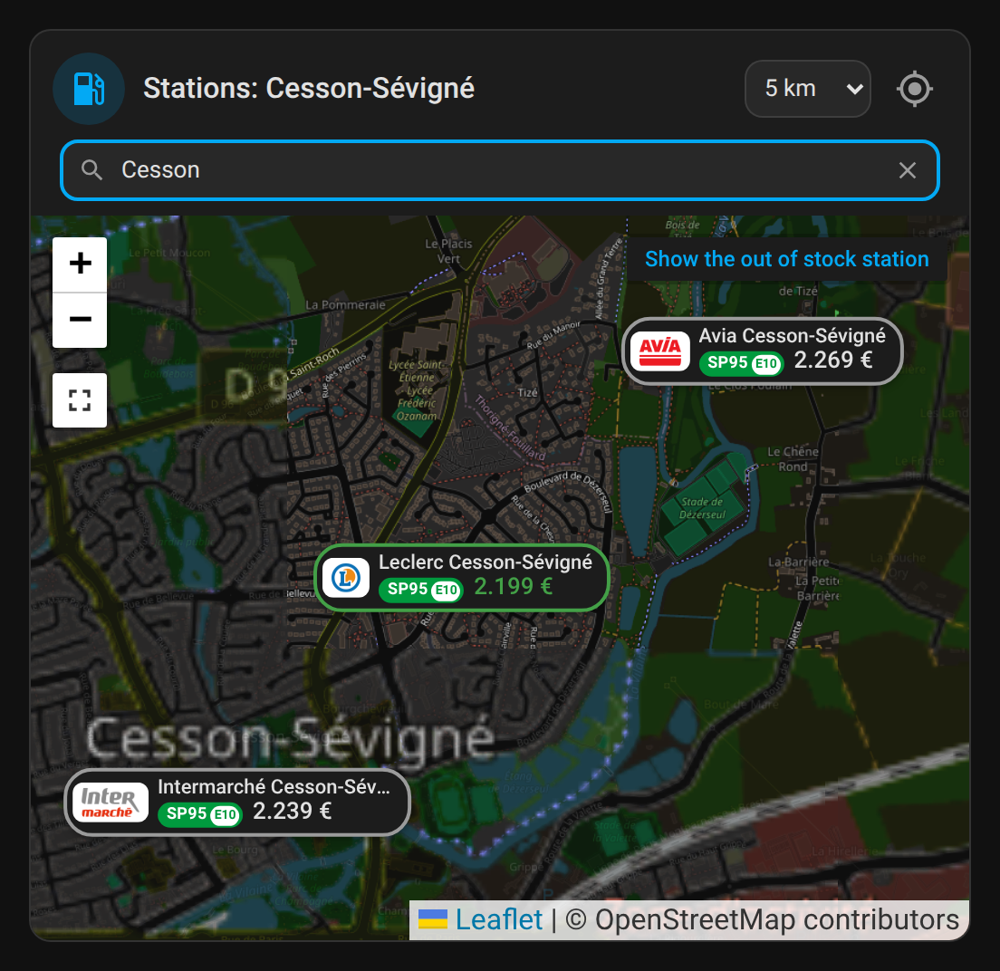

# ha-carburants-france

[](https://github.com/hacs/integration)
[](https://github.com/juju35/ha-carburants-france/actions/workflows/hacs.yml)
[](https://github.com/juju35/ha-carburants-france/actions/workflows/validate.yml)
[](https://github.com/juju35/ha-carburants-france/releases/latest)
[](LICENSE)

Home Assistant integration for [fuel prices in France](https://data.economie.gouv.fr/explore/assets/prix-des-carburants-en-france-flux-instantane-v2/view/): follow the prices and availability of fuels at your stations, with a Lovelace card included that shows the brand logos.

[](https://my.home-assistant.io/redirect/hacs_repository/?owner=juju35&repository=ha-carburants-france&category=integration)


## Features

- Official data from the French government's live feed, **no API key**, one request for all your stations
- **Station search in the configuration form**: around your home (adjustable radius), by postcode, town, department or station id, with the prices shown to help you choose
- Choice of the **fuels to follow**: Gazole (diesel), SP95, SP98, E10, E85, GPLc (LPG)
- Per station and per fuel: a **Price** sensor (€/L, with history) and an **In stock** binary sensor (temporary or permanent shortage, with its start date)
- Per fuel: a **Best price** sensor across your stations, with the station as attributes
- **Brand and logo** of each station: 42 French networks' logos built in, the others found automatically through OpenStreetMap and Wikidata
- `carburants_france.refresh` action to force an update
- `custom:carburants-france-card` card, **shipped with the integration** and loaded automatically: logos, prices, shortages, best price in green, live opening status, opening hours, services and directions on click
- `custom:carburants-france-map-card` map card: your stations on a map, with the logo and the price of a fuel on each marker, your home, and the station details on click; **Locate me** button to see the stations around you (radius picked in the title) and **search by town**, without adding them to the integration
- Add or remove stations and fuels at any time from the options
- English and French

## Prerequisites

- Home Assistant 2024.12 or later
- No account or API key: the data is public ([data.economie.gouv.fr](https://data.economie.gouv.fr/explore/assets/prix-des-carburants-en-france-flux-instantane-v2/view/))
- Your home location set in Home Assistant, for the search around your home and the distances

## Installation

### Via HACS (recommended)

Click the button below to add the repository directly:

[](https://my.home-assistant.io/redirect/hacs_repository/?owner=juju35&repository=ha-carburants-france&category=integration)

Then click **Download** and restart Home Assistant.

Or manually:

1. Open HACS → **⋮** (top right) → **Custom repositories**
2. Add `https://github.com/juju35/ha-carburants-france` — Type: **Integration**
3. Search for **Carburants France** and click **Download**
4. Restart Home Assistant

The cards are **part of the integration**: at startup they are added to the dashboard resources (`/carburants_france_static/carburants-france-card.js`, module). After an install or an update, restart Home Assistant and refresh the browser (clear the companion app cache if needed).

If your dashboards are in YAML mode, the cards are loaded on every page without going through the resources.

### Manual

Copy `custom_components/carburants_france/` to `/config/custom_components/carburants_france/`, then restart Home Assistant.

## Configuration

### Integration

[](https://my.home-assistant.io/redirect/config_flow_start/?domain=carburants_france)

**Settings → Devices & services → Add integration → Carburants France**, then:

1. **Name and fuels**: give a name ("Fuel", "Work"…) and tick the fuels to follow.
2. **Search**: leave empty to search around your home within the chosen radius, or enter a postcode (`35000`), a town (`Rennes`), a department (`35`) or a station id (`35000013`).
3. **Stations**: tick the stations to follow. Each line shows the brand, the address, the prices of the chosen fuels (✕ when out of stock) and the distance. Tick **New search** to add stations elsewhere: the selection is kept.

Options (**Configure** button):

| Option | Default | Description |
|---|---|---|
| Fuels to follow | Gazole | Fuels for which sensors are created |
| Followed stations | — | Untick a station to stop following it |
| Add stations | — | Runs the search again to add stations |
| Rename stations | — | Next step: one name per station, empty to keep the automatic name |
| Update interval | 15 min | Minimum 5 min: the government feed is updated every 10 minutes |

Several entries are possible, for example one around your home and one along your commute.

### Entities

Each station is a device, named after its brand and town (can be renamed in Home Assistant). Entity ids are created in French.

| Entity | Example | Description |
|---|---|---|
| Price | `sensor.leclerc_rennes_gazole` | Price in €/L. Unknown during a shortage. Attributes: update date, shortage, address, distance |
| In stock | `binary_sensor.leclerc_rennes_gazole_disponible` | On when the fuel is available. Attributes: shortage type (`temporaire`, `definitive`) and start date |
| Best price | `sensor.carburants_meilleur_prix_gazole` | Lowest price across the stations where the fuel is available, with the station as attributes |
| Stations | `sensor.carburants_stations` | Number of followed stations, all the data as attributes (used by the cards) |

A fuel in permanent shortage (no longer sold) has no entity, nor has a fuel that is not followed.

The feed sometimes publishes neither a price nor a shortage for a fuel, usually right after a shortage ends, before a new price is entered. The fuel then shows **No price**, with an unknown price and availability, until the next published price.

### Card

Add the **Carburants France** card from the card picker: every option is set in the visual editor. In YAML:

```yaml
type: custom:carburants-france-card
```

| Option | Default | Description |
|---|---|---|
| `entity` | detected | Stations sensor to show (useful with several entries) |
| `title` | `Fuel` | Card title |
| `fuels` | all | Fuels shown, for example `[gazole, e10]` |
| `sort` | `price` | `price`, `distance`, `name` or `config` (configuration order) |
| `sort_fuel` | first fuel | Fuel used to sort by price |
| `max_stations` | `0` | Maximum number of stations shown (`0` = all) |
| `show_icon` | `true` | Icon next to the title, opening the data page on data.economie.gouv.fr |
| `show_logo` | `true` | Brand logo (colored initials when no logo is known) |
| `show_brand` | `true` | Brand in full, before the address ("Total Access", "TotalEnergies"…) |
| `show_address` | `true` | Address and town |
| `show_distance` | `true` | Distance from home |
| `show_hours` | `true` | Open, closed, 24/7 or 24/7 automatic pump, with the closing or opening time |
| `show_updated` | `true` | Age of each price |
| `show_out_of_stock` | `true` | Show fuels in temporary shortage |
| `highlight_best` | `true` | Best price of each fuel in green with a star |
| `show_refresh` | `true` | Refresh button |
| `hide_out_of_stock_stations` | `true` | Hide the stations where every fuel shown is out of stock |

Click a station to see its weekly opening hours, its services and a directions button. One station is expanded at a time; a click outside the card collapses it and hides the out-of-stock stations again.

Stations where **every fuel shown is out of stock** are hidden: the **Show the out of stock stations** button at the bottom of the card brings them back.

### Map card

Add the **Carburants France — carte** card from the card picker. In YAML:

```yaml
type: custom:carburants-france-map-card
```

| Option | Default | Description |
|---|---|---|
| `entity` | detected | Stations sensor to show (useful with several entries) |
| `title` | `Stations map` | Card title, `""` to hide it |
| `show_icon` | `true` | Icon next to the title, opening the data page on data.economie.gouv.fr |
| `show_fullscreen` | `true` | Full screen button, under the zoom buttons |
| `fuel` | cheapest | Fuel shown on the markers. Without a value, each marker shows the cheapest available fuel of the station, with its name ("E10 1,990 €") |
| `height` | `400` | Map height in pixels |
| `zoom` | fitted | Fixed zoom; by default the map fits all the stations |
| `map_style` | `ha` | Base map, see below |
| `theme` | `auto` | Base map theme: `auto` (follows the Home Assistant theme), `light` or `dark` (darkened, except aerial photos) |
| `tile_url` | — | With `map_style: custom`: tile URL with `{z}`, `{x}`, `{y}` (and `{s}` if needed) |
| `tile_attribution` | — | With `map_style: custom`: attribution shown at the bottom of the map. Leaflet renders it as HTML, so links work: only put text you trust there |
| `show_home` | `true` | Show your home |
| `show_logo` | `true` | Brand logo on the markers |
| `show_name` | `true` | Station name on the markers, above the price |
| `hide_out_of_stock_stations` | `true` | Hide the stations where every followed fuel is out of stock (button at the top right to show them) |
| `show_locate` | `true` | **Locate me** button and radius list in the title |
| `radius` | `5` | Default radius of **Locate me**, in km (up to 50) |
| `show_search` | `true` | Search field under the title, to show the stations of a town (or a postcode) |

Each marker shows the logo and the price: green for the best price of that fuel, orange when every followed fuel is out of stock. Click a marker to see all the prices, the opening status and the directions. The full screen button enlarges the map to the whole screen (on iPhone, where full screen is not available, it covers the page); Escape or the same button closes it.

**Locate me** (crosshairs button in the title) shows the stations within the radius picked next to it (5 km by default) around you: your browser's position (HTTPS or the companion app), else your person's position, else your home. The title says so, the search area is drawn and your position is marked; changing the radius searches again. The **search field** shows the stations of a town (or a postcode, a department) and focuses the map on that town; the cross clears it. Neither adds anything to the integration: stations you already follow keep their name and logo and are marked as followed in their popup. Clicking **Locate me** again, or clearing the search, brings back your followed stations.

Scroll-wheel zoom is disabled so it doesn't get in the way of scrolling the dashboard (use the buttons or pinch).

Available base maps, all without an API key:

| `map_style` | Base map |
|---|---|
| `ha` | **Home Assistant**: the base map of the native Home Assistant map card (2026.9 and later), OpenStreetMap vector tiles with its light or dark style. Without WebGL2, or before 2026.9, the map falls back to `osm` |
| `osm` | OpenStreetMap raster tiles, served by Home Assistant itself (built-in **Map tiles** integration, 2026.9 and later); straight from OpenStreetMap before 2026.9 |
| `osm_fr` | [OpenStreetMap France](https://www.openstreetmap.fr) |
| `ign` | IGN map ([Géoplateforme](https://geoservices.ign.fr)) |
| `ign_photo` | IGN aerial photos (France only) |
| `topo` | [OpenTopoMap](https://opentopomap.org), with relief |
| `cyclosm` | [CyclOSM](https://www.cyclosm.org), cycling oriented |
| `satellite` | Esri World Imagery satellite imagery |
| `custom` | Your own tiles (`tile_url`), for example a self-hosted server |

```yaml
type: custom:carburants-france-map-card
map_style: custom
tile_url: https://tiles.example.org/{z}/{x}/{y}.png
tile_attribution: © OpenStreetMap contributors
```

### Automations

Get notified when diesel drops below 2 € at one of your stations:

```yaml
triggers:
  - trigger: numeric_state
    entity_id: sensor.carburants_meilleur_prix_gazole
    below: 2
actions:
  - action: notify.mobile_app_phone
    data:
      title: Diesel at {{ states('sensor.carburants_meilleur_prix_gazole') }} €
      message: "{{ state_attr('sensor.carburants_meilleur_prix_gazole', 'station_name') }}"
```

Get notified of a shortage:

```yaml
triggers:
  - trigger: state
    entity_id: binary_sensor.leclerc_rennes_gazole_disponible
    to: "off"
actions:
  - action: notify.mobile_app_phone
    data:
      message: Diesel out of stock at Leclerc Rennes
```

## Screenshots

While prices refresh, the card animates: the refresh button spins until the update finishes. It settles to a still card once done (and honours `prefers-reduced-motion`).



While it looks up the stations around you, the "locate me" button pulses until the nearby list is ready. It settles to a still card once done (and honours `prefers-reduced-motion`).



| Light | Dark (station expanded, sorted by distance) |
|---|---|
|  |  |

| All fuels | All fuels, dark |
|---|---|
|  |  |

| Map | Map, dark |
|---|---|
|  |  |

| Locate me (2 km) | Search by town, dark |
|---|---|
|  |  |

Screenshots are in English; station names, addresses and fuel names at the pump stay French, like the feed.

## How it works

The integration downloads the government's live feed at the update interval, in a single request for every followed station, and creates the price, availability and best-price entities from it.

### Names, brands and logos

The government feed gives neither the name nor the brand of the stations.

**Name and brand** come first from the community file [`stations_name.json`](https://github.com/Aohzan/hass-prixcarburant/blob/master/custom_components/prix_carburant/stations_name.json) of Aohzan's [hass-prixcarburant](https://github.com/Aohzan/hass-prixcarburant) project (about 9,200 stations, Apache 2.0 licence), updated every week and corrected by its users. It is downloaded at most once a week and cached. To fix or add a station for everyone, suggest a change to that file on its repository.

For stations missing from that file, the integration looks in [OpenStreetMap](https://www.openstreetmap.org) (`ref:FR:prix-carburants` tag, otherwise the closest station within 300 m). If OpenStreetMap only has a generic name ("Station-service") or the brand name, the station is named after its brand and town, or failing that its address.

Name priority: custom name (**Rename stations** option), community file, OpenStreetMap, brand and town, address.

The logos of 42 French networks ship with the integration (`frontend/brands`): Leclerc, Intermarché, Carrefour, U, Auchan, Casino, Lidl, TotalEnergies, Total Access, Esso, Shell, BP, Avia, Agip… The card finds them from the brand, then from the station name ("Intermarché Cesson-Sévigné"), and uses them before the Wikidata logo, which is often missing, an old version, or the same for sister brands (Total and Total Access). The brand is also written in full on the list card and in the map card popup. Brand logos are trademarks of their owners.

The **logo** comes from the brand found in OpenStreetMap, through [Wikidata](https://www.wikidata.org) / Wikimedia Commons. The lookup is done once, when the station is added; if OpenStreetMap can't be reached, it is retried at the next startup. Without a known logo, the card shows the brand initials.

### Map

The map card uses [Leaflet](https://leafletjs.com) and, for the `ha` base map, [MapLibre GL](https://maplibre.org) with its Leaflet adapter, at the same versions as Home Assistant; everything ships with the integration, no CDN. The `ha` base map reuses the style served by your instance (`/static/map/light.json` or `dark.json`) and follows the light or dark theme. For the other base maps, the dark theme darkens the tiles, except aerial photos.

### Data sources

- Prices and stations: French Ministry of the Economy, [live feed v2](https://data.economie.gouv.fr/explore/assets/prix-des-carburants-en-france-flux-instantane-v2/view/), Licence Ouverte
- Station names: [hass-prixcarburant](https://github.com/Aohzan/hass-prixcarburant) community file (Aohzan and contributors), Apache 2.0
- Brands: © [OpenStreetMap](https://www.openstreetmap.org/copyright) contributors, ODbL
- Logos: Wikimedia Commons, through Wikidata; TotalEnergies and Total Access logos built into the cards, trademarks of TotalEnergies, used only to identify the stations
- Base maps: © OpenStreetMap contributors, OpenStreetMap France, IGN, OpenTopoMap, CyclOSM, Esri depending on the base map chosen

## Development

```bash
pip install -r requirements_test.txt && pytest
pip install playwright && playwright install chromium
python scripts/screenshots.py   # renders the list card, the map card, and the refreshing/locate GIFs (needs ffmpeg)
```

### Releasing

1. Bump the version in `custom_components/carburants_france/manifest.json`, `const.py` and `CARBURANTS_CARD_VERSION` in the card
2. Add a `## <version>` section at the top of [CHANGELOG.md](CHANGELOG.md)
3. Push to `main`: the **Release** workflow creates the tag and the GitHub release with the changelog section as notes

## Translations

The integration and the cards follow the language of Home Assistant. Currently supported:

| Language | Code |
|---|---|
| English | `en` |
| Français | `fr` |

Contributions for additional languages are welcome!

## License

[MIT](LICENSE)
